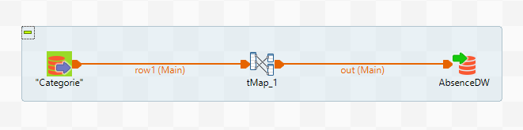
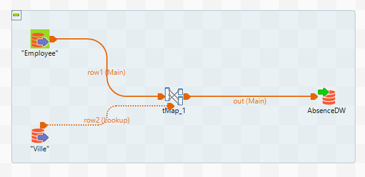
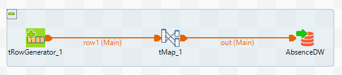
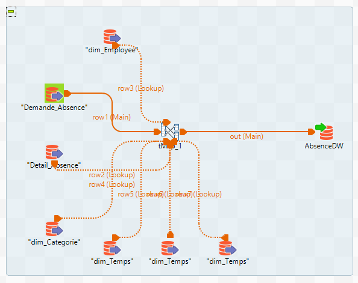

# Talend ETL Jobs (`DWH_AbsenceDB`)

This folder contains the exported Talend Open Studio jobs (`DWH_AbsenceDB_jobs.zip`) and mapping documentation used to extract data from `AbsenceDB`, transform dimensions and date keys, and load the `AbsenceDW` data warehouse.

## Contents

* `DWH_AbsenceDB_jobs.zip` — Exported Talend items archive containing:

  * `jDim_Categorie 0.1`

  * `jDim_Employee 0.1`

  * `jDim_Temps2 0.1`

  * `jFait_Absence 0.1`

* `images/` — Job design and `tMap` configuration screenshots.

## Prerequisites

1. **Source Database Ready:** Execute `01-source-db/AbsenceDB_source.sql` in SSMS so `AbsenceDB` is populated.

2. **Target Warehouse Database Created:** Create an empty database named **`AbsenceDW`** in SQL Server (`CREATE DATABASE AbsenceDW;`) before running the jobs (Talend creates and populates the dimension and fact tables automatically).

3. **Talend Open Studio for Data Integration** installed with SQL Server JDBC drivers configured.

## How to Import the Jobs into Talend

1. Open **Talend Open Studio** and open your workspace/project.

2. In the **Repository** panel on the left, right-click **Job Designs** and select **Import items**.

3. Choose **Select archive file**, click **Browse...**, and select `02-talend-etl/DWH_AbsenceDB_jobs.zip`.

4. Ensure the `DWH_AbsenceDB` folder (and all 4 jobs + dependencies) are checked. *(Check **Overwrite existing items** only if updating an older version).*

5. Click **Finish**. The `DWH_AbsenceDB` folder will appear under **Job Designs**.

## Configure Database Connections & Verify Schemas Before Running

Although the exported archive includes metadata/schemas, your collaborator should update and test the SQL Server connection to **`AbsenceDB`** (and **`AbsenceDW`**) on their machine—and re-retrieve schemas only if a component or table schema needs refreshing:

1. In **Repository** $\rightarrow$ **Metadata** $\rightarrow$ **Db Connections** (or directly in each job's DB input/output components), update the SQL Server settings to match your local instance:

   * **Host / Server:** `localhost` (or your SQL Server instance name)

   * **Port:** `1433`

   * **Source Database:** `AbsenceDB`

   * **Target Warehouse Database:** `AbsenceDW`

   * **Username & Password:** Your local SQL Server credentials

2. Click **Check** / **Test connection** to confirm Talend can connect to `AbsenceDB` and `AbsenceDW`.

3. *(Optional / Troubleshooting)* If any input component reports a schema mismatch, right-click the `AbsenceDB` connection in **Metadata** $\rightarrow$ **Db Connections**, select **Retrieve schema**, choose the source tables (`Ville`, `Employee`, `Categorie`, `Demande_Absence`, `Detail_Absence`), and sync them with the job components.

## Execution Order

Run the jobs in the following dependency order so dimension surrogate keys exist before the fact table performs lookups:

1. **`jDim_Categorie 0.1`** — Creates and loads absence categories into `dim_Categorie`.

2. **`jDim_Employee 0.1`** — Joins `Employee` with `Ville` (`nom`, `region`, `pays`) and creates/loads `dim_Employee`.

3. **`jDim_Temps2 0.1`** — Generates a continuous calendar dimension (`SK_Temps` formatted as `yyyyMMdd` `int`, `date_complete`, `jour`, `mois`, `trimestre`, `annee`) covering the full absence date range (`2024-12-26` to `2025-12-18`+).

4. **`jFait_Absence 0.1`** — Joins `Demande_Absence` and `Detail_Absence` at the atomic request grain (`num_demande`), resolves `SK_Temps` separately for `date_demande`, `date_debut`, and `date_fin` via three `dim_Temps` lookups, and creates/loads `Fait_Absence` (100 rows).

## Job Screenshots

### `jDim_Categorie`

### `jDim_Employee`

### `jDim_Temps2`

### `jFait_Absence`

